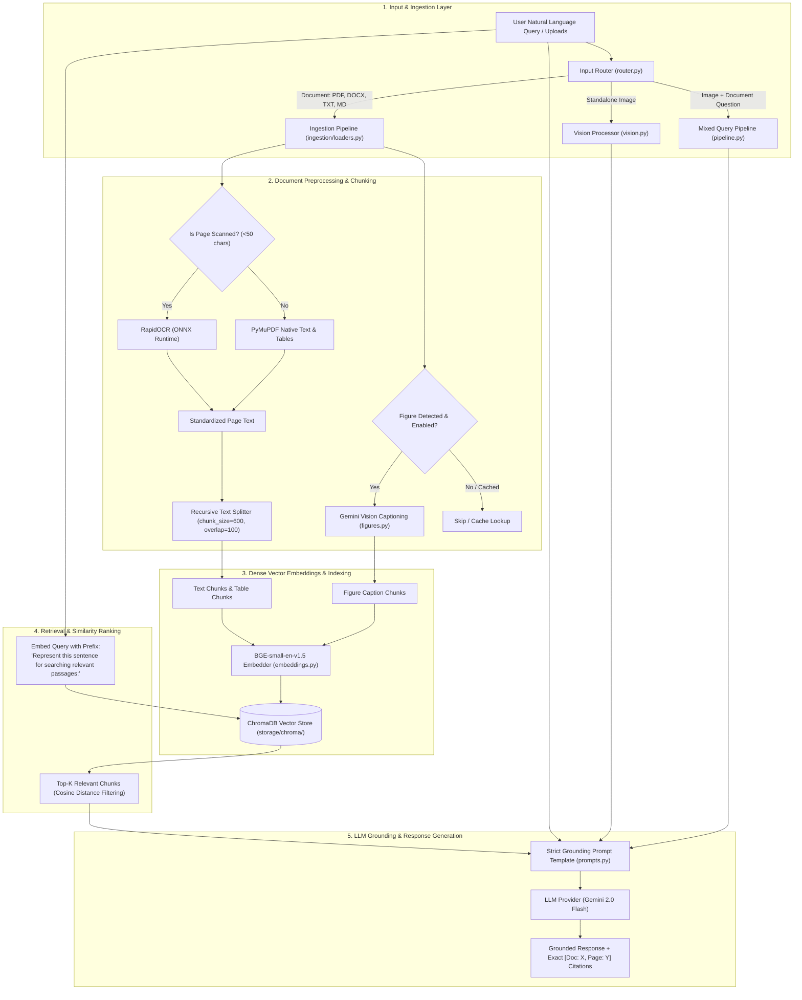

# System Architecture & Technical Specifications

**Project Title**: Multimodal AI Assistant for Intelligent Document and Visual Understanding  
**Degree**: Bachelor of Technology (B.Tech) Capstone Project  
**Target Environment**: Cross-platform (Windows / macOS / Linux) with Python 3.11+

---

## 1. High-Level Architecture Overview

The system bridges unstructured multimodal data (textual documents, structured tables, visual diagrams, and user images) with a Large Language and Vision Model via Retrieval-Augmented Generation (RAG).

---

## 2. Component Design & Responsibilities

### 2.1 Configuration (`config.py`)
- Centralized `AppConfig` loading from `.env`.
- Automatically initializes persistent directories (`storage/chroma`, `storage/uploads`, `storage/cache`).
- Type-safe hyperparameters: chunk sizes, overlap, similarity cutoff, model IDs.

### 2.2 LLM & Vision Provider (`llm/base.py`, `llm/gemini.py`)
- Abstract base class `LLMProvider` decoupling business logic from proprietary APIs.
- `GeminiProvider` implements exponential backoff on HTTP 429 / `RESOURCE_EXHAUSTED` errors to respect free-tier 15 RPM limits.
- Supports both text generation and multimodal inputs (passing image bytes directly into `google.genai.types.Part`).

### 2.3 Local Embedder (`embeddings.py`)
- Uses `BAAI/bge-small-en-v1.5` via `sentence-transformers`.
- Dimension size: 384.
- Asymmetry handling: Queries are prepended with `"Represent this sentence for searching relevant passages: "`, whereas passages are indexed raw.

### 2.4 Vector Store (`vectorstore.py`)
- ChromaDB embedded persistence in `storage/chroma/`.
- Metadata schema:
  - `doc_id`: Unique document identifier (SHA-256 hash).
  - `filename`: Original uploaded filename.
  - `page`: 1-based page number.
  - `chunk_type`: `text`, `table`, `figure_caption`, or `ocr`.
  - `chunk_index`: Sequential integer index within the document.

### 2.5 Ingestion & OCR (`ingestion/`)
- `loaders.py`: PyMuPDF (`pymupdf`) for PDFs, `python-docx` for Word documents, standard Python for Markdown and TXT.
- `chunking.py`: `RecursiveCharacterTextSplitter` with separator hierarchy `["\n\n", "\n", " ", ""]`. Preserves table blocks intact.
- `ocr.py`: `rapidocr-onnxruntime` detects and recognizes text on scanned or rasterized pages without external system C++ binaries.
- `figures.py`: Rasterizes diagram-heavy PDF pages, queries Gemini Vision for a concise semantic description, and caches the result by image hash to prevent duplicate API calls.

### 2.6 User Interface (`app/streamlit_app.py`)
- Interactive web frontend with file manager sidebar, citation badges, collapsible source inspector, and image attachment preview.
