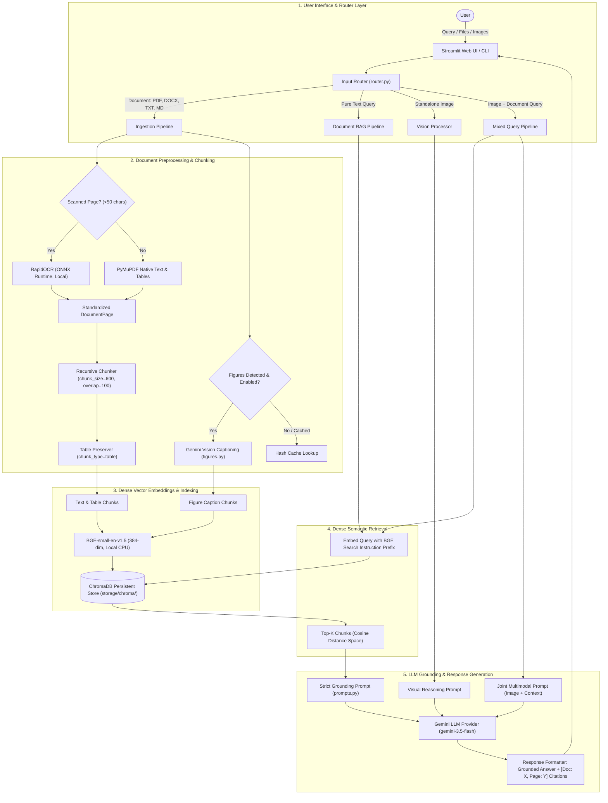

# Multimodal AI Assistant: System Architecture & Technical Specifications

**Project Title**: Multimodal AI Assistant for Intelligent Document and Visual Understanding  
**Degree**: Bachelor of Technology (B.Tech) Capstone Project  
**Author**: Capstone Candidate  
**Target Environment**: Cross-platform (Windows / macOS / Linux) with Python 3.11+

---

## 1. High-Level Architectural Overview

The system bridges unstructured multimodal data (textual documents, structured tables, visual diagrams, and user images) with a Large Language and Vision Model via Retrieval-Augmented Generation (RAG).



---

## 2. Component Specifications & Interfaces

### 2.1 Input Processing & Routing (`src/mmassistant/router.py`)
Incoming requests are classified into four execution pathways to avoid unnecessary computations:
- `DOCUMENT_INGEST`: Ingests and indexes uploaded documents into ChromaDB.
- `TEXT_DOC_QUERY`: Pure text question answered via ChromaDB dense retrieval.
- `IMAGE_QUERY`: Visual analysis of an attached image without querying document storage.
- `MIXED_QUERY`: Joint cross-modal reasoning fusing an attached image with retrieved document context chunks in a single multimodal prompt.

### 2.2 Ingestion & Optical Character Recognition (`src/mmassistant/ingestion/`)
- **Native Document Loaders (`loaders.py`)**:
  - `PyMuPDF` (`pymupdf`): Fast PDF extraction. Retains exact 1-indexed page numbers.
  - `python-docx`: Extracts Word paragraphs and tables into structured markdown blocks.
  - `load_text`: UTF-8/Latin-1 text and markdown parser.
  - `compute_file_hash`: Generates SHA-256 hashes for instant deduplication.
- **Scanned PDF Handling & OCR (`ocr.py`)**:
  - Automatically identifies scanned or sparse pages with `< 50` characters of extractable text.
  - Rasterizes pages to 150 DPI PNG images and runs `RapidOCR` (pure Python/ONNX, zero host dependencies).
  - Calculates confidence scores; if confidence falls below threshold (0.60), falls back to Gemini Vision for transcription.
- **Figure Extraction & Captioning (`figures.py`)**:
  - Detects pages with vector schematics, graphs, or drawings.
  - Queries Gemini Vision to generate technical semantic descriptions of charts, axes, and trends.
  - Indexes descriptions as `figure_caption` chunks, allowing diagrams to be retrieved via natural language search.
  - Implements SHA-256 caching in `storage/cache/figures.json` and caps processing at 5 pages per doc to conserve API quota.

### 2.3 Chunking Strategy & Table Preservation (`src/mmassistant/ingestion/chunking.py`)
- Employs `RecursiveCharacterTextSplitter` with separators `["\n\n", "\n", ". ", " ", ""]`.
- **Target Size**: 600 characters ($\approx 100-150$ tokens).
- **Overlap**: 100 characters to prevent loss of boundary entities.
- **Table Preservation**: Markdown tables are identified and kept intact as single indivisible `chunk_type="table"` chunks so numerical rows are never split across chunks.

### 2.4 Vector Database & Embeddings (`src/mmassistant/embeddings.py`, `vectorstore.py`)
- **Embedding Model**: `BAAI/bge-small-en-v1.5` (133M parameters, 384 dimensions).
- **Asymmetric Prefix**:
  - Search queries: `"Represent this sentence for searching relevant passages: {query}"`.
  - Passages: Raw text without prefix.
- **ChromaDB**: Embedded persistent vector store with HNSW indexing over cosine distance.
- **Chunk Metadata Schema**:
  ```json
  {
    "doc_id": "e04c3d0bd1a32b3d",
    "filename": "sample_document.md",
    "page": 1,
    "chunk_type": "text | table | figure_caption | ocr",
    "chunk_index": 0,
    "doc_hash": "e04c3d0bd1a32b3d..."
  }
  ```

### 2.5 Strict Grounding & Anti-Prompt-Injection (`src/mmassistant/prompts.py`)
- Quarantines retrieved text inside `<context>` XML tags.
- Directs the LLM to treat document text strictly as passive data, completely ignoring any malicious instructions embedded in documents.
- Mandatory citation syntax: `[Doc: <filename>, Page: <page>]`.
- Zero-hallucination refusal: *"I cannot find sufficient information in the provided documents to answer this question."*

### 2.6 User Interface (`app/streamlit_app.py`)
- Interactive web frontend with file manager sidebar, citation badges, collapsible source inspector, and image attachment preview.
